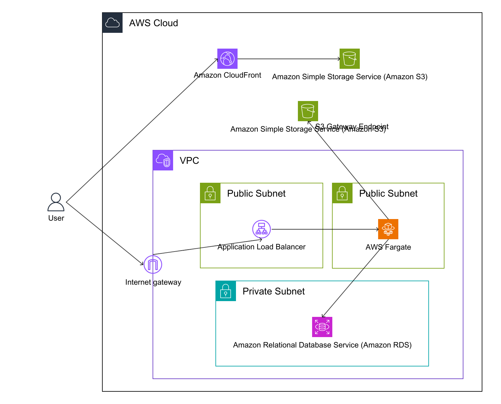
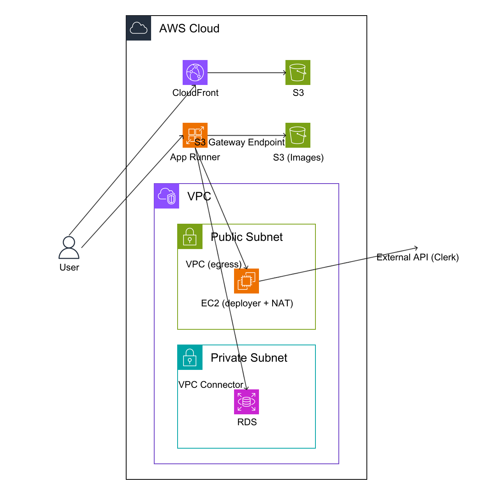
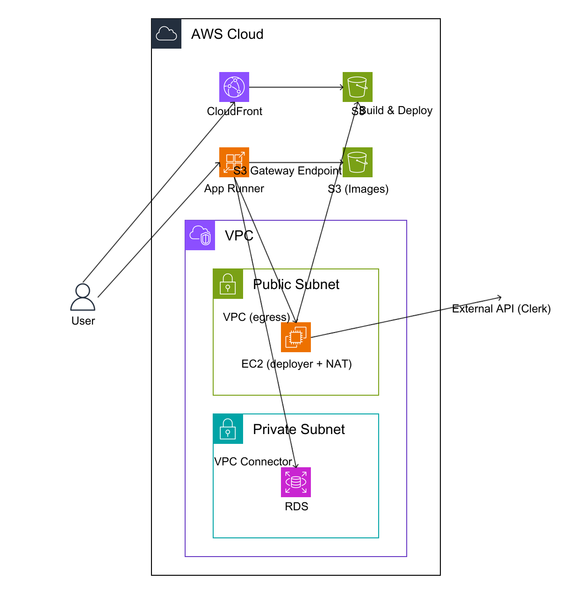

# Deploy Comparison App

A personal learning project created while exploring deployment options for potential workplace use. It compares AWS App Runner with ALB + ECS Fargate using the same full-stack application and Terraform configuration.

The application provides sample user CRUD operations and an image gallery. It is a learning and infrastructure comparison exercise, with limitations documented in [ARCHITECTURE.md](ARCHITECTURE.md) and [SECURITY.md](SECURITY.md).

## Technology

| Layer                  | Technology                                                           |
| ---------------------- | -------------------------------------------------------------------- |
| Frontend               | React, Vite, TypeScript, Tailwind CSS                                |
| Backend                | Node.js, Express, TypeScript                                         |
| Authentication         | Clerk                                                                |
| Database               | PostgreSQL, Prisma, Amazon RDS                                       |
| State management       | Zustand                                                              |
| Testing                | Vitest, React Testing Library, Supertest                             |
| Infrastructure         | Terraform                                                            |
| Continuous integration | GitHub Actions: lint, tests, builds, and static Terraform validation |

## Deployment modes

Set `deploy_mode` to select a configuration. CloudFront, frontend S3 storage, image S3 storage, ECR, and RDS are shared across modes.

| Value                | Backend                    | Outbound internet access                               |
| -------------------- | -------------------------- | ------------------------------------------------------ |
| `ecs`                | ALB + ECS Fargate          | Public task IPs                                        |
| `apprunner`          | App Runner + VPC Connector | Managed NAT Gateway                                    |
| `apprunner_deployer` | App Runner + VPC Connector | EC2 instance that also builds and deploys the frontend |





See [ARCHITECTURE.md](ARCHITECTURE.md) for traffic flow, authentication, monitoring, and operational tradeoffs. See [terraform/README.md](terraform/README.md) for infrastructure setup.

## Local development

Prerequisites: Node.js 24, npm, Docker with Docker Compose, and a Clerk application for frontend sign-in.

Run these commands from the repository root:

```bash
git clone https://github.com/SomaTomita/app-runner-test.git
cd app-runner-test

# Install frontend dependencies and configure its public settings.
cd frontend
npm ci
cp .env.example .env
# Set VITE_CLERK_PUBLISHABLE_KEY. Leave VITE_API_URL empty to use the Vite proxy.
cd ..

# Start PostgreSQL and the development backend.
docker compose up -d

# Create the database schema and load sample users.
docker compose exec backend npx prisma migrate dev
docker compose exec backend npx prisma db seed

# Start the frontend at http://localhost:5173.
cd frontend
npm run dev
```

Docker Compose supplies the backend database URL and enables development mode. Without Clerk backend keys, development mode bypasses API authentication; both PostgreSQL and the backend are bound to localhost. The frontend still requires Clerk sign-in. Use sample data only.

For a backend running outside Docker, provide the environment variables below, generate Prisma Client, and run `npm run dev` from `backend/`. The server reads process environment variables; copying an environment file alone does not load it into the server process.

## Environment variables

### Backend

| Variable                | Purpose                                                             |
| ----------------------- | ------------------------------------------------------------------- |
| `DATABASE_URL`          | PostgreSQL connection URL; required                                 |
| `CLERK_PUBLISHABLE_KEY` | Clerk application publishable key                                   |
| `CLERK_SECRET_KEY`      | Clerk server secret; keep private                                   |
| `ALLOWED_USER_IDS`      | Comma-separated Clerk user IDs permitted to access the API          |
| `NODE_ENV`              | `development`, `test`, or `production`                              |
| `PORT`                  | HTTP port; defaults to `3000`                                       |
| `STORAGE_TYPE`          | `local` for sample files or `s3` for AWS storage                    |
| `S3_IMAGES_BUCKET`      | Image bucket used in S3 mode                                        |
| `AWS_REGION`            | AWS region; defaults to `ap-northeast-1`                            |
| `BASE_URL`              | Base URL for local image links; defaults to `http://localhost:3000` |
| `CORS_ORIGINS`          | Comma-separated allowed browser origins                             |

Production startup requires both Clerk keys and `ALLOWED_USER_IDS`. Only allowlisted users may use protected API endpoints. These users share the sample records; the app does not implement separate accounts or tenants in its database.

### Frontend

| Variable                     | Purpose                                                         |
| ---------------------------- | --------------------------------------------------------------- |
| `VITE_CLERK_PUBLISHABLE_KEY` | Public Clerk application key; required                          |
| `VITE_API_URL`               | Backend origin; leave empty for Vite or CloudFront API proxying |

Vite embeds `VITE_*` values in the browser bundle. Put only public configuration in these variables.

## Checks without AWS resources

```bash
# Repository lint and formatting checks.
npm ci
npm run lint
npm run format:check

# Backend checks; Prisma generation does not require a database connection.
cd backend
npm ci
npx prisma generate
npm test
npm run lint
npm run build
cd ..

# Frontend checks.
cd frontend
npm ci
npm test
npm run lint
npm run build
cd ..

# Static Terraform checks only; these do not create AWS resources.
terraform -chdir=terraform fmt -check -recursive
terraform -chdir=terraform init -backend=false
terraform -chdir=terraform validate
# Terraform 1.7+ supports these plans with mock providers and no AWS calls.
terraform -chdir=terraform test
```

Unit tests mock database, storage, and authentication dependencies. CI also starts the production Docker image against a disposable local PostgreSQL database to check migrations, startup, CRUD, access rejection, and repeat startup. CI does not deploy AWS infrastructure.

```bash
docker build --tag learning-backend:check backend
bash scripts/check-production-container.sh learning-backend:check
```

## Optional AWS deployment

Deployment incurs AWS charges and requires a separate, deliberate setup. This repository can be studied and tested locally without creating any AWS resources.

Before using the Terraform configuration, read [the setup guide](terraform/README.md) and [the learning environment limitations](ARCHITECTURE.md#learning-environment-limitations). Build and push the backend image to ECR before creating a service that references it. The production container applies committed migrations before starting. Follow [the deployment sequence](docs/DEPLOYMENT.md) for ECR bootstrapping, AMD64 image publishing, infrastructure creation, and frontend delivery. Automated AWS deployment workflows are not included.

## Useful commands

Run commands from the indicated directory:

| Directory           | Command                                               | Purpose                                       |
| ------------------- | ----------------------------------------------------- | --------------------------------------------- |
| Repository root     | `docker compose down`                                 | Stop local containers                         |
| Backend or frontend | `npm test`                                            | Run tests once                                |
| Backend or frontend | `npm run test:watch`                                  | Watch tests during development                |
| Backend             | `npx prisma studio`                                   | Open the database UI                          |
| Backend             | `npx prisma migrate dev`                              | Create or apply development migrations        |
| Backend             | `npx prisma migrate deploy`                           | Apply committed migrations to a deployment    |
| Repository root     | `./backend/scripts/upload-images.sh <S3_BUCKET_NAME>` | Upload sample images to an existing S3 bucket |

## Repository structure

```text
app-runner-test/
├── frontend/             # React UI, API client, stores, and component tests
├── backend/              # Express API, Prisma schema, sample images, and tests
├── terraform/            # Infrastructure modules and environment presets
├── .github/workflows/    # Checks without AWS deployment
├── diagrams/             # English diagram definitions and rendered PNG files
├── docker-compose.yml    # Local PostgreSQL and backend
├── ARCHITECTURE.md       # Design and operational limitations
└── SECURITY.md           # Security model and disclosure guidance
```
